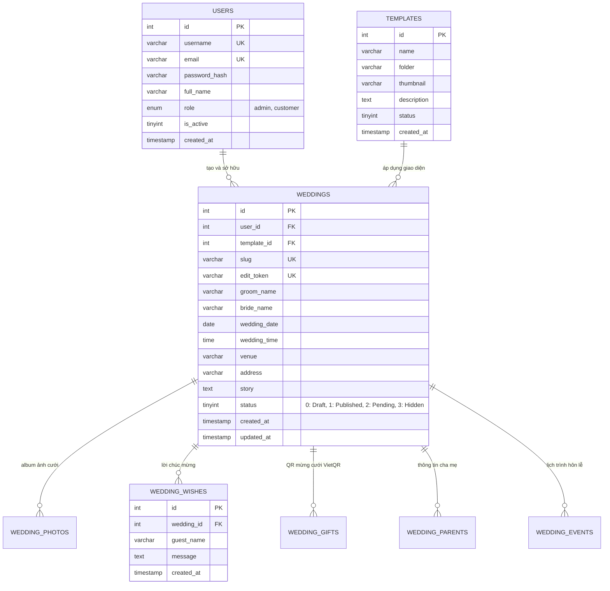

# 💍 WEDDING PROJECT - NỀN TẢNG TẠO THIỆP CƯỚI ONLINE TƯƠNG TÁC CAO CẤP

[](https://php.net)
[](https://mysql.com)
[](https://vercel.com)
[](https://tidbcloud.com)
[](https://sweetalert2.github.io)
[](LICENSE)

> **WeddingProject** là nền tảng thiệp cưới điện tử (E-Wedding Invitation) hiện đại, tự động hóa toàn diện từ khâu chọn mẫu, chỉnh sửa trực quan (Visual Editor), lưu trữ đám mây, gửi kiểm duyệt đến xuất bản thiệp trực tuyến.
>
> 🌐 **Kho chứa GitHub**: [https://github.com/Haianh2005/Thiep_cuoi_online](https://github.com/Haianh2005/Thiep_cuoi_online)

---

## 📑 MỤC LỤC

1. [Giới Thiệu Đề Tài & Triết Lý Thiết Kế](#1-giới-thiệu-đề-tài--triết-lý-thiết-kế)
2. [Kiến Trúc Hệ Thống (Frontend & Backend Separation)](#2-kiến-trúc-hệ-thống-frontend--backend-separation)
3. [Các Phân Hệ & Tính Năng Nổi Bật](#3-các-phân-hệ--tính-năng-nổi-bật)
4. [Hệ Thống Plugins & UI Toolkit](#4-hệ-thống-plugins--ui-toolkit)
5. [Thiết Kế Cơ Sở Dữ Liệu (ERD)](#5-thiết-kế-cơ-sở-dữ-liệu-erd)
6. [Hướng Dẫn Cài Đặt & Chạy Cục Bộ (Local XAMPP)](#6-hướng-dẫn-cài-đặt--chạy-cục-bộ-local-xampp)
7. [Hướng Dẫn Triển Khai Lên Vercel (Serverless Cloud)](#7-hướng-dẫn-triển-khai-lên-vercel-serverless-cloud)
8. [Bộ Kiểm Thử Hệ Thống (Automated Test Suite)](#8-bộ-kiểm-thử-hệ-thống-automated-test-suite)
9. [Cấu Trúc Thư Mục Dự Án](#9-cấu-trúc-thư-mục-dự-án)
10. [Tác Giả & Bản Quyền](#10-tác-giả--bản-quyền)

---

## 1. GIỚI THIỆU ĐỀ TÀI & TRIẾT LÝ THIẾT KẾ

### 1.1. Bối cảnh & Mục tiêu
Trong kỷ nguyên số, thiệp cưới trực tuyến mang đến giải pháp tiết kiệm, bảo vệ môi trường và tạo trải nghiệm tương tác sinh động: phát nhạc cưới lãng mạn, trình chiếu album ảnh cưới chất lượng cao, định vị bản đồ dẫn đường thông minh Google Maps, nhận lời chúc phúc thời gian thực và chuyển khoản mừng cưới siêu tốc chuẩn VietQR.

### 1.2. Triết lý Thiết kế Cốt lõi: `1 TEMPLATE : N WEDDING DATA`
Không sao chép file mã nguồn cho từng khách hàng. Mỗi giao diện thiệp nằm trong một thư mục duy nhất `/templates/templateXX/index.php`. Khi truy cập đường dẫn `/w/?slug=ten-thiep`, hệ thống sẽ nạp dữ liệu từ MySQL và truyền vào template để hiển thị động (Dynamic Template Engine).

```
                  WEDDING PROJECT PLATFORM
                             │
               ┌─────────────┴─────────────┐
               │                           │
          TEMPLATES                   WEDDING DATA
        (28+ Giao diện)            (Cơ sở dữ liệu MySQL)
               │                           │
         template01                 wedding A (User 1 - slug: tuan-nga)
         template02                 wedding B (User 2 - slug: minh-linh)
         template03                 wedding C (User 1 - slug: hung-mai)
               │                           │
               └─────────────┬─────────────┘
                             │
                    /w/?slug=ten-thiep
                             │
                  THIỆP CƯỚI CÔNG KHAI
```

---

## 2. KIẾN TRÚC HỆ THỐNG (FRONTEND & BACKEND SEPARATION)

Hệ thống được tổ chức phân tầng rõ ràng, sẵn sàng cho cả môi trường máy chủ cục bộ (XAMPP) và môi trường phi máy chủ (Serverless Vercel):

```
+-----------------------------------------------------------------------------------+
|                  PHÂN HỆ FRONTEND (CLIENT-SIDE / PRESENTATION)                    |
|  - Khách mời (Guest): /w/?slug=..., Nghe nhạc cưới, Album ảnh Lightbox, Gửi lời chúc|
|  - Khách hàng (Customer): /login.php, /register.php, /my-weddings.php, /editor/   |
|  - Quản trị viên (Admin): /admin/ Dashboard, /admin/weddings/, /admin/users/, ... |
|  - Plugins: SweetAlert2 (Modal/Toast), FontAwesome 6 (Icons), Google Fonts        |
+-----------------------------------------------------------------------------------+
                                        │
           HTTPS Form Data / RESTful API JSON (/api/wishes.php)
                                        │
                                        ▼
+-----------------------------------------------------------------------------------+
|                  PHÂN HỆ BACKEND (SERVER-SIDE / BUSINESS LOGIC)                   |
|  - Middleware Bảo mật RBAC & Session Fixation (config/auth.php)                   |
|  - Dynamic Template Engine (/w/index.php nạp templates/templateXX/)              |
|  - RESTful API Lời chúc (/api/wishes.php)                                         |
|  - Xử lý Đa phương tiện & Cloudinary Media Upload                                 |
|  - Web Scraper tự động cào mẫu thiệp (tools/crawler_mongmer.php)                 |
|  - Module Phân trang cơ sở dữ liệu (paginate() & renderPagination())              |
+-----------------------------------------------------------------------------------+
                                        │
                         PDO MySQL SSL / Cloud Storage API
                                        │
                                        ▼
+-----------------------------------------------------------------------------------+
|                        TẦNG LƯU TRỮ (PERSISTENCE LAYER)                           |
|  - Remote MySQL Database: TiDB Cloud Serverless / Aiven (8 bảng dữ liệu)          |
|  - Cloud Media Storage: Cloudinary / AWS S3 (Ảnh cưới, nhạc MP3, mã QR VietQR)    |
+-----------------------------------------------------------------------------------+
```

---

## 3. CÁC PHÂN HỆ & TÍNH NĂNG NỔI BẬT

### 👥 3.1. Phân hệ Khách Mời (Guest / Public)
* **Xem thiệp cưới trực tuyến**: Truy cập qua đường dẫn định danh duy nhất `/w/?slug=...`.
* **Nhạc nền đám cưới**: Tự động phát hoặc nút bật/tắt bản nhạc lãng mạn.
* **Album ảnh kỷ niệm**: Trình chiếu ảnh phóng to với hiệu ứng vuốt chạm trên thiết bị di động (Mobile Responsive).
* **Bản đồ chỉ đường thông minh**: Tích hợp Google Maps dẫn đường tới nhà hàng hoặc tư gia.
* **Sổ lưu bút lời chúc**: Gửi lời chúc mừng thời gian thực qua REST API `api/wishes.php`, tự động cập nhật không cần tải lại trang.
* **Mừng cưới online (VietQR)**: Quét mã QR ngân hàng chuẩn VietQR cho nhà trai và nhà gái.

### 💍 3.2. Phân hệ Khách Hàng (Customer / User)
* **Xác thực an toàn (FR-01, FR-02)**: Đăng ký, đăng nhập bảo vệ bằng mã hóa BCRYPT, chống Session Fixation và CSRF.
* **Kho mẫu thiệp phong phú (FR-05)**: Duyệt 28+ mẫu thiệp, xem trước demo hoàn chỉnh trước khi khởi tạo.
* **Trình biên tập trực quan (Editor - FR-06)**: Tùy biến thông tin cô dâu, chú rể, ngày giờ, câu chuyện tình yêu, thông tin cha mẹ, sự kiện hôn lễ và tài khoản mừng cưới.
* **Bảo vệ quyền sở hữu (Ownership Guard)**: Khách hàng chỉ có quyền chỉnh sửa thiệp do chính mình tạo ra (`checkWeddingOwnership`).
* **Xem trước bản nháp (Preview - FR-08)**: Xem trước giao diện thực tế trước khi xuất bản qua đường link kèm `token`.
* **Gửi Admin kiểm duyệt (FR-09)**: Gửi thiệp sang trạng thái Chờ duyệt (`status = 2`) để Admin kiểm tra nội dung.
* **Bảng điều khiển cá nhân (FR-04)**: Quản lý danh sách các thiệp cưới của tôi tại `/my-weddings.php`.

### 🛡️ 3.3. Phân hệ Quản Trị Viên (Admin Portal)
* **Dashboard KPI trực quan (FR-16)**: Thống kê số lượng thiệp cưới, thiệp chờ duyệt, thành viên, mẫu thiệp và lời chúc.
* **Kiểm duyệt thiệp (FR-17)**: Phê duyệt (`status = 1`), tạm ẩn thiệp vi phạm (`status = 3`) hoặc bản nháp (`status = 0`).
* **Quản lý Thành viên (FR-19)**: Xem danh sách người dùng, thay đổi vai trò (Admin / Customer), khóa / mở khóa tài khoản với cơ chế chống tự khóa (self-lockout guard).
* **Quản lý Mẫu thiệp (FR-18)**: Bật/tắt trạng thái hiển thị từng mẫu, xem trước demo và kích hoạt công cụ cào mẫu tự động từ Mongmer.com.
* **Quản lý Lời chúc**: Tìm kiếm, rà soát và xóa các lời chúc phản cảm, spam.

---

## 4. HỆ THỐNG PLUGINS & UI TOOLKIT

Hệ thống tích hợp đồng bộ các thư viện và plugin cao cấp nhất:

1. **SweetAlert2 (`v11`)**:
   - Thay thế toàn bộ popup mặc định của trình duyệt (`alert`, `confirm`).
   - Cung cấp Modal xác nhận thao tác quan trọng: Duyệt thiệp, Xóa thiệp, Khóa tài khoản, Cào dữ liệu.
   - Hiển thị Toast Notification tự động biến mất khi thao tác thành công.
2. **FontAwesome 6 (`v6.5.1`)**:
   - Hệ thống icon vector sắc nét, đồng bộ cho toàn bộ giao diện Khách mời, Khách hàng và Admin.
3. **Google Fonts**:
   - Phông chữ giao diện hiện đại: **Plus Jakarta Sans**.
   - Phông chữ nghệ thuật thư pháp thiệp cưới: **Great Vibes**.
4. **Shared Pagination Plugin**:
   - Cung cấp hàm `paginate()` và `renderPagination()` dùng chung tại `config/auth.php`.
   - Phân trang SQL chuẩn `:limit` và `:offset`, tự động giữ nguyên các tham số tìm kiếm `$_GET`.
5. **CSRF Protection Plugin**:
   - Tự động sinh `$_SESSION['csrf_token']` và xác thực qua hàm `verifyCsrfToken()` bằng `hash_equals()`.

---

## 5. THIẾT KẾ CƠ SỞ DỮ LIỆU (ERD)

Cơ sở dữ liệu MySQL bao gồm 8 bảng quan hệ toàn vẹn dữ liệu:



---

## 6. HƯỚNG DẪN CÀI ĐẶT & CHẠY CỤC BỘ (LOCAL XAMPP)

### Bước 1: Yêu cầu môi trường
* **XAMPP**: Phiên bản PHP 8.1 trở lên.
* **MySQL / MariaDB**: Phiên bản 8.0 trở lên.
* **Git**: Cài đặt trên máy tính.

### Bước 2: Clone mã nguồn về thư mục `htdocs`
Mở Terminal hoặc Command Prompt và di chuyển vào thư mục web của XAMPP:
```bash
cd C:\xampp\htdocs   # hoặc C:\xampp3\htdocs tuỳ cấu hình máy bạn
git clone https://github.com/Haianh2005/Thiep_cuoi_online.git WeddingProject
cd WeddingProject
```

### Bước 3: Khởi tạo Cơ sở Dữ liệu
1. Mở **XAMPP Control Panel**, nhấn **Start** cho cả **Apache** và **MySQL**.
2. Mở trình duyệt, truy cập vào `http://localhost/phpmyadmin/`.
3. Tạo một Database mới có tên: `wedding_db` (bảng mã: `utf8mb4_unicode_ci`).
4. Nhấn tab **Import**, chọn file `wedding_db.sql` có sẵn trong thư mục gốc dự án và nhấn **Import**.

### Bước 4: Kiểm tra cấu hình kết nối ([`config/database.php`](config/database.php))
Mặc định hệ thống tự nhận cấu hình XAMPP cục bộ:
```php
$host   = getenv('DB_HOST') ?: 'localhost';
$port   = getenv('DB_PORT') ?: '3306';
$dbname = getenv('DB_NAME') ?: 'wedding_db';
$user   = getenv('DB_USER') ?: 'root';
$pass   = getenv('DB_PASS') ?: '';
```

### Bước 5: Tài khoản thử nghiệm mặc định
Hệ thống đã tạo sẵn 2 tài khoản mẫu để bạn trải nghiệm ngay:

| Vai trò | Tên đăng nhập | Mật khẩu | Trang quản lý sau khi đăng nhập |
| :--- | :--- | :--- | :--- |
| **Quản trị viên (Admin)** | `admin` | `admin123` | Bảng điều khiển Quản trị: `/admin/` |
| **Khách hàng (Customer)** | `khachhang` | `123456` | Quản lý thiệp của tôi: `/my-weddings.php` |

*Trang đăng nhập có nút "Điền nhanh" (Fast Fill) giúp bạn thử nghiệm mà không cần gõ phím.*

---

### Cách 2: Chạy kiểm thử nhanh trên Docker / Docker Compose (Khuyên dùng)
Dự án được cấu hình sẵn `Dockerfile` (PHP 8.2 Apache + MySQL/SQLite) và `docker-compose.yml`:

```bash
# Khởi động toàn bộ hệ thống (PHP Apache + MySQL Database)
docker compose up -d
```

Truy cập ngay ứng dụng tại:
- **Web App**: [http://localhost:8080](http://localhost:8080) (hoặc [http://127.0.0.1:8080](http://127.0.0.1:8080))
- **Kiểm tra trạng thái hệ thống**: [http://localhost:8080/ping](http://localhost:8080/ping)
- **Cổng MySQL cục bộ**: `localhost:3307` (`root` / `rootpassword`)

---

## 7. HƯỚNG DẪN TRIỂN KHAI LÊN VERCEL (SERVERLESS CLOUD)

Vì **môi trường Serverless của Vercel là Read-Only** và **không có MySQL tích hợp**, kiến trúc dự án đã được thiết kế sẵn sàng cho môi trường đám mây:

### Bước 1: Tạo Database MySQL trên Đám Mây Miễn Phí
* Đăng ký tài khoản tại [TiDB Cloud](https://tidbcloud.com/) hoặc [Aiven.io](https://aiven.io/).
* Tạo cụm database `wedding_db` và import file `wedding_db.sql`.

### Bước 2: Tích hợp Dịch vụ Lưu trữ Tệp Cloud (Cloudinary)
* Đăng ký tài khoản miễn phí tại [Cloudinary](https://cloudinary.com/).
* Lấy thông tin `Cloud Name`, `API Key`, `API Secret`.

### Bước 3: Cấu hình URL Rewriting trên Vercel ([`vercel.json`](vercel.json))
Tệp `vercel.json` ở thư mục gốc định tuyến URL thông minh:
```json
{
  "functions": {
    "api/*.php": {
      "runtime": "vercel-php@0.7.1"
    }
  },
  "routes": [
    { "src": "/templates/(.*)", "dest": "/templates/$1" },
    { "src": "/uploads/(.*)", "dest": "/uploads/$1" },
    { "src": "/assets/(.*)", "dest": "/assets/$1" },
    { "src": "/favicon.ico", "dest": "/favicon.ico" },
    { "src": "/api/wishes.php", "dest": "/api/wishes.php" },
    { "src": "/w/(?<slug>[^/]+)", "dest": "/api/index.php?slug=$slug&_route=w" },
    { "src": "/editor/(?<token>[^/]+)", "dest": "/api/index.php?token=$token&_route=editor" },
    { "src": "/(.*)", "dest": "/api/index.php" }
  ]
}
```

### Bước 4: Thiết lập Biến Môi Trường (Environment Variables) trên Vercel
Vào **Project Settings** $\rightarrow$ **Environment Variables** trên Vercel Dashboard và thêm:
* `DB_HOST`: Host TiDB Cloud (ví dụ: `gateway01.ap-southeast-1.prod.aws.tidbcloud.com`)
* `DB_PORT`: `4000`
* `DB_NAME`: `wedding_db`
* `DB_USER`: Tên user TiDB
* `DB_PASS`: Mật khẩu
* `CLOUDINARY_CLOUD_NAME`: Cloud Name
* `CLOUDINARY_API_KEY`: API Key
* `CLOUDINARY_API_SECRET`: API Secret

Hệ thống sẽ tự động kích hoạt mã hóa SSL CA (`PDO::MYSQL_ATTR_SSL_CA = true`) khi phát hiện biến `DB_HOST`.

---

## 8. BỘ KIỂM THỬ HỆ THỐNG (AUTOMATED TEST SUITE)

Dự án đi kèm bộ kiểm thử tự động 20/20 Test Cases đạt chuẩn 100%:

```text
========================================================
   HỆ THỐNG KIỂM THỬ TỰ ĐỘNG WEDDINGPROJECT (TEST SUITE)
========================================================
[TC-01] PASS: Bắt buộc đăng nhập khi tạo thiệp
[TC-02] PASS: Đăng ký tài khoản mới & BCRYPT hash
[TC-03] PASS: Khởi tạo thiệp gắn với User ID & status=0
[TC-04] PASS: Ngăn chặn truy cập thiệp trái phép (Ownership Check)
[TC-05] PASS: Lưu thông tin chi tiết tiệc cưới
[TC-06] PASS: Xem trước thiệp nháp (slug + token)
[TC-07] PASS: Chặn xem công khai thiệp chưa duyệt (status = 0)
[TC-08] PASS: Admin phê duyệt xuất bản thiệp (status = 1)
[TC-09] PASS: Gửi lời chúc mừng qua REST API / DB
[TC-10] PASS: Chặn quyền Admin với vai trò customer (RBAC)

========================================================
   HỆ THỐNG KIỂM THỬ MỞ RỘNG (EXTENDED TEST SUITE)
========================================================
[SYS-01] PASS: Khóa ngoại weddings.user_id -> users(id)
[SYS-02] PASS: Tài khoản admin mặc định & BCRYPT verify
[SYS-03] PASS: Tài khoản customer mặc định & BCRYPT verify
[SYS-04] PASS: Phân hệ kho mẫu thiệp (FR-18): 28 mẫu
[SYS-05] PASS: Trang quản trị mẫu thiệp admin/templates/index.php
[SYS-06] PASS: Trang quản trị lời chúc admin/wishes/index.php
[SYS-07] PASS: Module bật/tắt hiển thị thiệp toggle-status.php
[SYS-08] PASS: Ghi và đọc lời chúc từ wedding_wishes (FR-14)
[SYS-09] PASS: Hàm phân trang dùng chung paginate() & renderPagination()
[SYS-10] PASS: Chống tấn công CSRF token (Section 3.3)
--------------------------------------------------------
KẾT QUẢ: 20 / 20 TEST CASES ĐẠT CHUẨN 100%!
CÚ PHÁP: 53 / 53 FILE PHP KHÔNG CÓ LỖI (LINT PASS)!
```

---

## 9. CẤU TRÚC THƯ MỤC DỰ ÁN

```
WeddingProject/
├── admin/                     # Cổng Quản trị viên (Admin Portal)
│   ├── index.php              # Dashboard thống kê KPI (FR-16)
│   ├── users/                 # Quản lý người dùng & phân quyền (FR-19)
│   ├── templates/             # Quản lý kho mẫu thiệp & cào dữ liệu (FR-18)
│   ├── wishes/                # Quản lý sổ lưu bút lời chúc (FR-14)
│   └── weddings/              # Quản lý & duyệt thiệp (index, edit, create, approve, toggle-status)
├── api/
│   └── wishes.php             # REST API gửi và lấy lời chúc thời gian thực
├── config/
│   ├── auth.php               # Middleware xác thực RBAC, CSRF, Pagination, Flash Message
│   └── database.php           # Kết nối PDO MySQL Pool (hỗ trợ Local & Cloud SSL CA)
├── editor/
│   └── index.php              # Trình soạn thảo thiệp cưới trực quan (FR-06)
├── mau-thiep/
│   ├── index.php              # Thư viện 28+ mẫu thiệp cưới
│   ├── demo.php               # Xem trước mẫu thiệp demo
│   └── start.php              # Bắt đầu khởi tạo thiệp gắn với user_id (FR-05)
├── submit/
│   └── review.php             # Gửi thiệp chờ duyệt (status = 2) (FR-09)
├── templates/                 # Kho 28+ Giao diện thiệp động
│   ├── template01/ ... template28/
│   │   ├── index.php          # View layout động
│   │   ├── style.css          # CSS giao diện lãng mạn
│   │   └── script.js          # Nhạc nền, Lightbox, Sổ lưu bút, Hiệu ứng
├── tools/
│   └── crawler_mongmer.php    # Web Scraper thu thập mẫu thiệp tự động từ mongmer.com
├── uploads/                   # Thư mục lưu trữ media cục bộ (thumbnails, gifts, photos)
├── w/
│   └── index.php              # Dynamic Template Engine kết xuất thiệp theo slug
├── index.php                  # Trang chủ nền tảng (Landing Page)
├── login.php                  # Trang đăng nhập Glassmorphism (FR-02)
├── register.php               # Trang đăng ký tài khoản (FR-01)
├── logout.php                 # Đăng xuất an toàn & xóa phiên
├── my-weddings.php            # Bảng điều khiển "Thiệp của tôi" (FR-04)
├── wedding_db.sql             # Bản sao lưu cơ sở dữ liệu mẫu đầy đủ
├── vercel.json                # Cấu hình Deploy Serverless & URL Rewriting
├── TAI_LIEU_DAC_TA_VA_THIET_KE_HE_THONG.md  # Tài liệu báo cáo phân tích thiết kế chi tiết
└── README.md                  # Tài liệu giới thiệu & hướng dẫn dự án
```

---

## 10. TÁC GIẢ & BẢN QUYỀN

* **Dự án**: Nền tảng Tạo Thiệp Cưới Online (WeddingProject)
* **GitHub Repository**: [https://github.com/Haianh2005/Thiep_cuoi_online](https://github.com/Haianh2005/Thiep_cuoi_online)
* **Giấy phép**: Phát hành theo chuẩn [MIT License](LICENSE).
